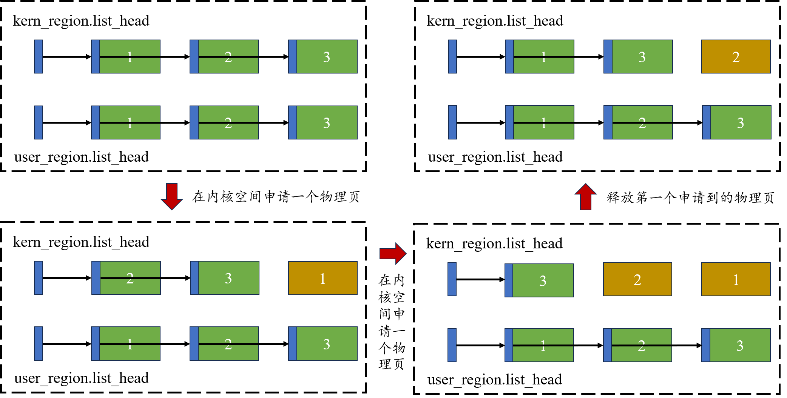
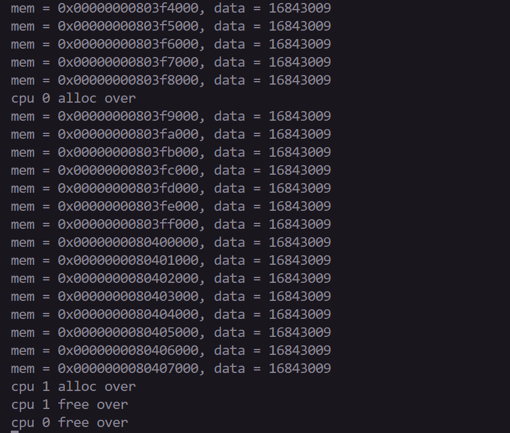
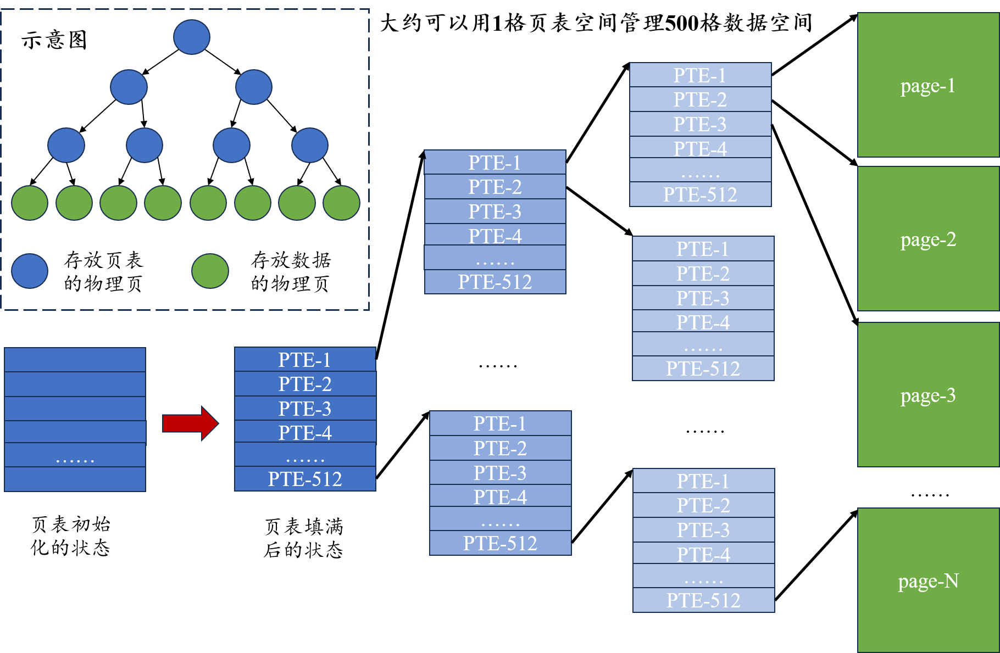
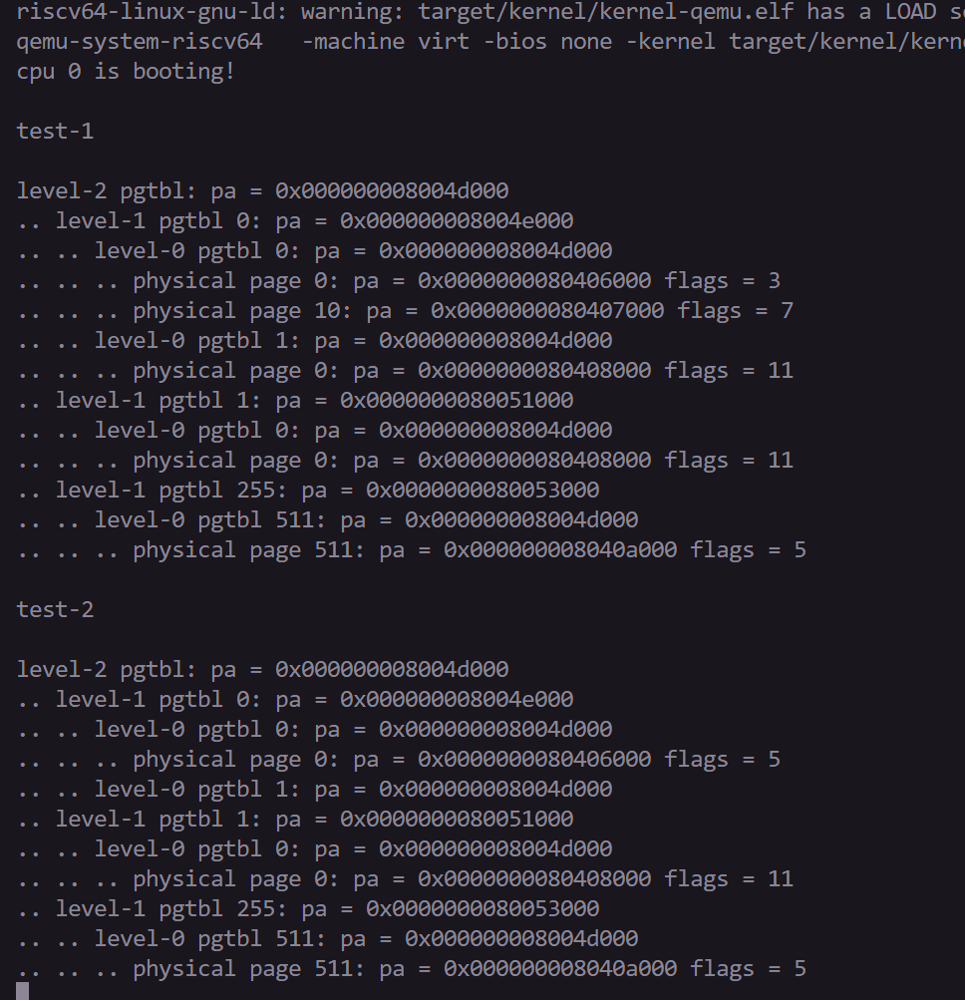
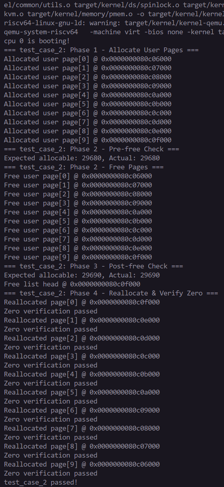

# AegisOS Lab 5：用户虚拟内存与系统调用

基于个人 Lab 4 提交 `928fa8e`，按助教 `lab5` 分支 `4a0f4b7` 的规格增量实现。先单独提交规格，再接平台、用户内存与验收；保留 Lab 4 的权限隔离、寄存器现场、失败回滚和紧急报错修复。

## 当前实现

- syscall 编号 0–7：helloworld、copyin、copyout、copyinstr、brk、mmap、munmap、printf；a7 为编号、a0..a5 为参数、a0 为结果。
- 用户指针经过逐页 V/U/R/W 检查；跨页复制与有界字符串复制均可返回失败，不触发内核 panic。printf 将用户字符串按原文输出，最多 127 字节加 NUL。
- brk 按字节记录堆顶；按页面增长/收缩。load/store 缺页只在合法栈区自动补齐全部中间页，成功后重试原指令。
- mmap 使用有序已分配区间链和带锁的 256 节点池，支持自动首次适配、固定地址、同权限合并及 munmap 裁剪/拆分/跨段解除。含空洞的解除失败且不改变原状态。
- 多页分配先在临时页表中完成，成功后无分配地提交；不足时原 PTE、进程元数据和空闲资源计数保持不变。
- 缩堆和 munmap 同时回收解除范围内的空页表页；保留根页表、仍有映射的相邻分支及特殊映射，无须等进程退出才归还内核页。
- 页表复制保留内容与权限，用户物理页独立；销毁统一回收用户页及页表，trapframe 由进程单独回收，trampoline 共享。用户故障后动态堆、栈和 mmap 资源全部回收，内核继续响应中断。
- 实际启动核 `boot_hartid` 创建唯一用户进程，辅助核留在内核；UART 接收和全局 ticks 归属该启动核。RX 中断为 IER bit0，TX bit1 不开启。
- 可选 `AEGIS=1`：Agent Group 保护原型，包含共享用户页预算、成员数上限、syscall允许集合与64事件审计环；默认关闭，不改变课程ABI。当前没有组级调度、用户态管理器或真实LLM运行能力。

默认课程路径维持单用户执行；可选`PROC_LIFECYCLE=1`支持单启动hart上的协作式fork/exit/wait/yield。timer抢占、exec、文件系统及浮点上下文切换尚未实现。

汇报与设计材料：[功能实现说明](docs/功能实现说明.md)（实现路径、边界、演示及后续依赖）、[竞赛参考与差异化路线](docs/竞赛参考与差异化路线.md)（2025获奖作品及借鉴来源）、[Agent验收记录](docs/AGENT_VALIDATION.md)。新增功能需同步维护实现说明。

研究与选型：[近期研究与成熟技术](docs/研究与技术选型.md)，含2025–2026论文、Linux/FreeBSD/运行时机制、阅读深度、采用顺序及实现映射。已应用分类分配失败事件、成功事件过滤及资源复制阶段的组继承。

后续路线：[阶段开发计划](docs/后续开发计划.md)。资源复制与可选协作式生命周期已完成；`make test-process`运行真实fork/exit/wait/yield/getpid、父子内存隔离、失败回收及孤儿测试。默认关闭扩展，启用方式为`PROC_LIFECYCLE=1`，[生命周期契约与验收](docs/PROCESS_VALIDATION.md)说明ABI、边界与证据。下一阶段做timer抢占RR，再做组级调度；目前没有抢占公平性结论。

## 构建与运行

需要 RISC-V GCC/binutils、make、xxd、Python 3 和 QEMU。macOS 可使用原生工具；Ubuntu 解包工具链先执行：

```bash
source ../env.sh
export OPENSBI="$OSLAB_ROOT/toolchain/usr/lib/riscv64-linux-gnu/opensbi/generic/fw_dynamic.bin"
make build PLATFORM=qemu
make run PLATFORM=qemu
```

正常安装的 QEMU 可不设置 OPENSBI，使用默认固件。QEMU 固定双 hart、130 MiB RAM，默认产物 `target/qemu/kernel/kernel-qemu.elf`。初次从旧构建迁移或切换宿主工具链时清理旧产物；普通源码/选项变化支持增量重编译。

默认用户程序演示数组往返、字符串、堆、多页栈和 mmap，输出 `lab-5 demo PASS` 后保持用户循环。输入字符可观察 UART 编辑回显，Ctrl-a 后 x 退出 QEMU。

```bash
make build PLATFORM=vf2
```

VF2 生成 `target/vf2/kernel/kernel-vf2.elf` 与 `kernel-vf2.bin`；后者包含供 U-Boot booti 使用的 RISC-V Image 头。两平台产物隔离。`make run/debug PLATFORM=vf2` 拒绝自动启动并提示使用 booti。

## 可重复验收

在仓库根目录执行：

```bash
make test-lab5
make test-lab4
make test-lab3
make test-agent
```

`make test` 默认运行 Lab 5。分组定位：

```bash
python3 tests/test_lab5.py --group copy
python3 tests/test_lab5.py --group heap-stack
python3 tests/test_lab5.py --group mmap
python3 tests/test_lab5.py --group pagetable
python3 tests/test_lab5.py --group platform
```

`make test-agent` 检查组共享预算、双hart单页预算竞争、只收紧策略与一致快照、heap/stack/mmap的配额与OOM回滚、真实ecall权限拒绝、预算复用、审计覆盖及故障清理；另验证关闭审计时保护仍有效、开启Aegis的Lab5负载和同目录开关切换。专用镜像配置为4页预算并拒绝copyout；普通 `make run AEGIS=1` 使用64页、1成员、全部课程服务权限。用户目前不能修改这些内核策略。

`AEGIS_AUDIT=0` 可独立关闭事件采集并保留保护，默认等于 `AEGIS`；`AEGIS_AUDIT_SUCCESS=0` 只过滤成功syscall事件，保留拒绝、故障和生命周期。组快照区分预算拒绝与实际分配失败，审计快照区分过滤与覆盖。`make bench-agent` 使用相同用户镜像比较基线、仅保护、全量审计和过滤审计四配置。已保存的[本轮四配置结果](docs/benchmarks/agent/2026-10-23-selected/README.md)与[历史三配置数据](docs/benchmarks/agent/2026-10-23/README.md)分别保留；这些QEMU数据不能推导为实板或真实Agent性能。

| 验收 | 内容 |
| --- | --- |
| 用户复制 | 非对齐跨页、不可读/不可写页、无 U 位、特殊页、NUL 边界、零长度、溢出与部分前缀 |
| 堆栈 | 字节堆顶、跨 2MiB/1GiB 边界收缩后的空表回收、一次跨多页扩栈、数据页/页表页 OOM、原树不变 |
| mmap | 节点耗尽、双核唯一所有权、合并/拆分/跨权限裁剪、含空洞拒绝、节点不足原子失败、解除后空表与节点全部归还 |
| 页表 | 全页内容/权限比对、独立物理页、逐分配失败注入、特殊映射保留、完整销毁 |
| 用户态端到端 | 参数高位检查、数组往返、brk、真实栈缺页、mmap 访问、动态资源保留后故障清理 |
| 权限回归 | 零页读取、代码写入、trapframe 读取、内核地址取指均停止用户程序，清理后 ticks 继续 |
| 平台 | 交替构建与无修改不重建、Image 头/BSS/入口、非法平台/核数拒绝；Linux 上运行实际 UART/PLIC 源码的 MMIO 探针 |
| Lab 4/3 | 整数现场跨用户 timer/UART 中断、未知调用、内存失败回滚、三种 panic 场景、内核态中断基线 |

日志保存在 `target/tests/lab5/` 与 `target/tests/`；测试有界等待并主动结束 QEMU。TESTING/LAB5_TEST 的测试入口不会进入默认镜像。Lab 4 的单 hart 测试在 Lab 5 按课程要求改为验证拒绝 CPUNUM=1；原单 hart 基线仍保存在 `lab-4` 分支。

## VF2 验收边界

当前已经完成 VF2 参考配置构建、Image 头/链接布局检查，以及 Ubuntu 宿主的实际 UART/PLIC 访问探针。**尚未进行本轮 VF2 实板启动及端到端验收。** 2026-10-22 用户确认暂时无法接线，先交付代码与可重复验收。

参考配置为 RAM 基址 0x40000000、加载地址 0x40200000、管理窗口结束 0x48200000、U74 hart1..4、4MHz timebase。每次上板前仍须核对实际 DTB、U-Boot 内存和保留区，确认管理窗口不覆盖固件或 DTB；继承固件串口配置。正常运行不自动 saveenv、不刷写固件。平台常量来源、待验项目及已验证结果见 [开发与验收记录](docs/LAB5_VALIDATION.md)。

规格位于 `spec/`；实施路线见 [开发计划](docs/LAB5_PLAN.md)。后续修改以当前完整契约为准，旧教学说明只作参考。

---

## Lab 2 参考记录

**前言**

在lab-1中, 我们学习了机器启动流程、UART设备驱动、格式化输出和自旋锁

完成lab-1后, OS内核已经可以进入main函数并掌控UART资源做一些输出了

在lab-2中, 我们要加载OpenSBI固件来简化boot流程, 并且认识和管理“程序除了CPU外最常访问的共享资源——内存”

内存管理的实现不是一步到位的, lab-2主要关注物理内存和内核态虚拟内存, 剩余部分将在后面的实验逐渐完善

## 代码组织结构
```
ECNU-OSLAB-2025-TASK
├── LICENSE        开源协议
├── registers.xml  配置了可视化调试环境
├── common.mk      Makefile中一些工具链的定义
├── Makefile       编译运行整个项目 (CHANGE, 支持OpenSbi)
├── kernel.ld      定义了内核程序在链接时的布局 (CHANGE, 修改了内核入口地址)
├── pictures       README使用的图片目录 (CHANGE, 日常更新)
├── README.md      实验指导书 (CHANGE, 日常更新)
└── src            源码
    └── kernel     内核源码
        ├── arch   RISC-V相关
        │   ├── method.h(CHANGE, 加入OpenSBI调用)
        │   ├── mod.h
        ├── ├── sbi.c(NEW)
        │   └── type.h(CHANGE)
        ├── boot   机器启动
        │   ├── entry.S(CHANGE, 从 a0 取得 hart ID，并将其传入start)
        │   └── start.c(TODO, 删除M-mode的寄存器操作)
        ├── lock   锁机制
        │   ├── spinlock.c
        │   ├── method.h
        │   ├── mod.h
        │   └── type.h
        ├── lib    常用库
        │   ├── cpu.c
        │   ├── print.c
        │   ├── uart.c
        │   ├── utils.c (NEW, 工具函数)
        │   ├── method.h (CHANGE, utils.c的函数声明)
        │   ├── mod.h
        │   └── type.h
        ├── mem    内存模块
        │   ├── pmem.c (TODO, 物理内存管理)
        │   ├── kvm.c (TODO, 内核态虚拟内存管理)
        │   ├── method.h (NEW)
        │   ├── mod.h (NEW)
        │   └── type.h (NEW)
        ├── trap   陷阱模块
        │   ├── method.h (NEW)
        │   ├── mod.h (NEW)
        │   └── type.h (NEW, 增加PLIC寄存器定义)
        └── main.c (TODO)
```
**标记说明**

**NEW**: 新增源文件, 直接拷贝即可, 无需修改

**CHANGE**: 旧的源文件发生了更新, 直接拷贝即可, 无需修改

**TODO**: 你需要实现新功能 / 你需要完善旧功能

## 第一阶段: 更加方便的启动OpenSBI

### 第一步: 从裸机到OpenSBI
从底层角度出发, 当前内核只依赖RISC-V体系结构的寄存器, 不依赖任何其他软件

在QEMU上执行时这一点是可以接受的, 但是在未来移植到物理开发板后一切将变得困难

为了便于移植工作, 我们需要引入OpenSBI作为系统底层支撑的一部分 (src/kernel/arch/type.h src/kernel/arch/sbi.c)
关于**OpenSBI**, 你需要知道这些事情:

1. OpenSBI工作在M-mode, 负责一切需要在M-mode做的工作; 有了它之后, OS内核从启动开始一直工作在S-mode, 不存在显式的M-mode与S-mode切换, 可以简化一些复杂逻辑

2. QEMU模式下: OpenSBI工作在**0x80000000-0x80200000**地址空间, 因此内核的**entry**需要调整为**0x80200000** (通过定义`KERNEL_BASE`)

3. 我们用到的OpenSBI包括: 串口读写、**TIMECMP**寄存器的设置(后续在lab3中实现中断中)、CPU核心的启动与关闭、刷新TLB

### 第二步: 内核启动路径的变化
我们知道, 原版的内核启动流程是: **entry.S** (M-mode) -> **start.c** (M-mode) -> **main.c** (S-mode)

新版的启动流程是: **OpenSBI** (M-mode) -> **entry.S**(S-mode) -> **start.c** (S-mode) -> **main.c** (S-mode)

带来的影响包括:

1. 对于entry.S: 不能执行类似**csrr**的M-mode特权指令, 还是需要执行SP指针的设置和PC指针跳转到start.c

2. 对于start.c: hartid不能通过寄存器读取 (M-mode特权指令), OpenSBI会将hartid作为参数传入,感兴趣的同学可以自行ai搜寻一下这里面的传递参数的约定

3. 对于start.c: 不需要执行中断委托、时钟初始化、状态欺骗等, 因为OpenSBI的存在简化了这些工作, 此时就是S-mode

4. 对于main.c: 核心的变化是只有一个CPU核心会自启动, 其他CPU核心都需要手动唤醒(通过SBI HSM硬件线程状态管理扩展,该扩展允许在S模式下通过软件请求改变hart状态); 

## 第二阶段: 物理内存

首先需要关注的文件是 **kernel.ld** 文件, 它规定了内核文件 **kernel-qemu.elf** 在载入内存时的布局

物理内存按照地址空间划分为四个部分：

- **0x80000000 ~ 0x80200000** 存放了 **固件OpenSBI**

- **0x80200000 ~ KERNEL_DATA** 存放了 **kernel-qemu.elf的代码**

- **KERNEL_DATA ~ ALLOC_BEGIN** 存放了 **kernel-qemu.elf的数据**

- **ALLOC_BEGIN ~ ALLOC_END** 属于 **未使用的可分配的物理页**

如果你想深入了解可执行文件(ELF)的布局信息, 可以自行查阅资料, 在lab-9中我们会再提

前两个区域的物理页会一直被内核占用, 不会纳入动态分配和回收的范围, 需要管理的只有第三个区域的物理页

首先介绍物理内存管理的基本原理: **4KB物理页切分 + 空闲链表组织**

**ALLOC_BEGIN ~ ALLOC_END** 这块物理空间被切分为N个4KB物理页(不会有剩余)

此外, 考虑到内核与用户空间的强制隔离, 我们设置了两个`alloc_region`, 基于**KENREL_PAGE**进行边界划分

`kernel_region` 记录了内核空间的空闲物理页情况, `user_region` 记录了用户空间的空闲物理页情况

`alloc_region` 描述了一组空闲页链表, 包括起止位置、空闲页面数量、链表头节点、保证一致性的锁

下面的图片显示了物理页的申请和释放在链表上是如何体现的



接下来讨论物理内存管理的函数实现:

```
void pmem_init();    // 初始化系统, 只调用一次
void* pmem_alloc();  // 申请一个空闲的物理页
void pmem_free();    // 释放一个之前申请的物理页
```

这三个函数体现了经典的共享资源管理方法：初始化共享资源, 占有共享资源, 释放共享资源

在**kernel/lib/utils.c**里我们新增了三个辅助函数, 能简化一些操作

为了保证资源共享的可靠性, 当尝试访问`alloc_region`时需要获取和释放自旋锁

## 第二阶段: 测试用例

**test-1**

```c
volatile static int started = 0;

volatile static int over_1 = 0, over_2 = 0;

static int* mem[1024];

extern void _entry(void);

int main()
{
    int cpuid = r_tp();

    if(cpuid == 0) {

        print_init();
        pmem_init();

        printf("cpu %d is booting!\n", cpuid);
        __sync_synchronize();
        started = 1;

        for (uint64 id = 1; id < NCPU; id++)
        {
            sbi_ret_t ret = sbi_hart_start(id, (uint64)_entry, 0);
            if (ret.error != SBI_SUCCESS)
            {
                printf("failed to start cpu %d: error %d\n",
                       (int)id, (int)ret.error);
                panic("sbi_hart_start");
            }
        }

        for(int i = 0; i < 512; i++) {
            mem[i] = pmem_alloc(true);
            memset(mem[i], 1, PGSIZE);
            printf("mem = %p, data = %d\n", mem[i], mem[i][0]);
        }
        printf("cpu %d alloc over\n", cpuid);
        over_1 = 1;
        
        while(over_1 == 0 || over_2 == 0);
        
        for(int i = 0; i < 512; i++)
            pmem_free((uint64)mem[i], true);
        printf("cpu %d free over\n", cpuid);

    } else {

        while(started == 0);
        __sync_synchronize();
        printf("cpu %d is booting!\n", cpuid);
        
        for(int i = 512; i < 1024; i++) {
            mem[i] = pmem_alloc(true);
            memset(mem[i], 1, PGSIZE);
            printf("mem = %p, data = %d\n", mem[i], mem[i][0]);
        }
        printf("cpu %d alloc over\n", cpuid);
        over_2 = 1;

        while(over_1 == 0 || over_2 == 0);

        for(int i = 512; i < 1024; i++)
            pmem_free((uint64)mem[i], true);
        printf("cpu %d free over\n", cpuid);        
 
    }
    while (1);    
}
```

这个测试用例的作用是：

1. cpu-0和cpu-1并行申请内核空间的全部物理内存, 赋值并输出信息

2. 待申请全部结束, 并行释放所有申请的物理内存

理想的输出结果可能是这样的：



**test-2**

```c
/*--------------------------------- 测试代码 ----------------------------------*/

// 测试目标：耗尽内核/用户区域内存 
void test_case_1()
{
    void *page = NULL;

    while (1)
    {
        page = pmem_alloc(true);
        // page = pmem_alloc(false);
    }
}

#define TEST_CNT 10

// 测试目标: 常规申请和释放操作
void test_case_2()
{
    alloc_region_t *user_ar = &user_region;
    uint64 user_pages[TEST_CNT];

    for (int i = 0; i < TEST_CNT; i++)
        user_pages[i] = 0;

    printf("=== test_case_2: Phase 1 - Allocate User Pages ===\n");
    for (int i = 0; i < TEST_CNT; i++)
    {
        user_pages[i] = (uint64)pmem_alloc(false);

        printf("Allocated user page[%d] @ %p\n", i, (void *)user_pages[i]);

        if (!(user_pages[i] >= user_ar->begin && user_pages[i] < user_ar->end))
        {
            printf("Assertion failed: Page address out of bounds! Page: %p, Region: [%p, %p)\n",
                   (void *)user_pages[i], (void *)user_ar->begin, (void *)user_ar->end);
            panic("Page address out of user region bounds");
        }

        memset((void *)user_pages[i], 0xAA, PGSIZE);
    }

    printf("=== test_case_2: Phase 2 - Pre-free Check ===\n");
    spinlock_acquire(&user_ar->lk);
    int expected_before = (user_ar->end - user_ar->begin) / PGSIZE - TEST_CNT;
    int actual = user_ar->allocable;
    printf("Expected allocable: %d, Actual: %d\n", expected_before, actual);
    assert(user_ar->allocable == expected_before, "Allocable count incorrect before free");
    spinlock_release(&user_ar->lk);

    printf("=== test_case_2: Phase 3 - Free Pages ===\n");
    for (int i = 0; i < TEST_CNT; i++)
    {
        pmem_free(user_pages[i], false);
        printf("Free user page[%d] @ %p\n", i, (void *)user_pages[i]);
    }

    printf("=== test_case_2: Phase 4 - Post-free Check ===\n");
    spinlock_acquire(&user_ar->lk);
    int expected_after = (user_ar->end - user_ar->begin) / PGSIZE;
    actual = user_ar->allocable;
    printf("Expected allocable: %d, Actual: %d\n", expected_after, actual);
    assert(user_ar->allocable == expected_after, "Allocable count not restored after free");
    if (user_ar->list_head.next != NULL)
        printf("Free list head @ %p\n", user_ar->list_head.next);
    else
        panic("Free list is empty after freeing pages");
    spinlock_release(&user_ar->lk);

    printf("=== test_case_2: Phase 5 - Reallocate & Verify Zero ===\n");
    for (int i = 0; i < TEST_CNT; i++)
    {
        void *page = pmem_alloc(false);
        printf("Reallocated page[%d] @ %p\n", i, page);

        bool non_zero = false;
        for (int j = 0; j < PGSIZE / sizeof(int); j++)
        {
            if (((int *)page)[j] != 0)
            {
                non_zero = true;
                printf("Non-zero value detected at offset %d: 0x%x\n", j, ((int *)page)[j]);
                break;
            }
        }
        assert(!non_zero, "Memory not zeroed after free");
        printf("Zero verification passed\n");
    }

    printf("test_case_2 passed!\n");
}
```

这个测试用例的作用是：

1. 测试内存耗尽的`panic`是否正常触发

2. 测试用户空间物理页申请和释放的正确性

## 第三阶段: 内核态虚拟内存

完成物理内存管理的部分后, 你应该注意到“内存”和“串口”这两种共享资源的区别:

**串口资源是没有区别的, 而内存资源被细分为很多个通过"地址"来区分的4KB物理页**

- 因此, 我们需要一种机制来记录每个程序获得了哪些4KB物理页面

- 此外, 考虑到内存编程模型的灵活性和通用性, 我们需要给各个应用程序提供“独占内存资源”的幻觉

为了实现这两个目的, 我们引入**虚拟内存**这一重要概念

简单来说, 我们要建立一个表格, 用于记录虚拟地址空间到物理地址空间的对应关系, 并通过MMU自动完成翻译

**kernel/mem/type.h** 中的注释介绍了虚拟内存的一种规范**SV39**, 即39 bit虚拟地址的虚拟内存

之所以要遵守这个规范, 是为了能在RISC-V体系结构的机器上正常使用MMU,  你可以查看手册获得更多信息

虚拟内存的构建围绕两个核心概念：**页表项(PTE)** 和 **页表(pgtbl)**

页表是由页表项构成的, 你可以理解成数组和数组里元素的关系

一个页表项对应一个物理页, 页表项主要由两部分组成：

- 它所管理的物理页的**页号** (PPN字段)

- 它所管理的物理页的**标志位** (低10bit)

**提示:** 页表本身也是存放在物理页中, 这种物理页的特点是PTE的标志位中`PTE_R PTE_W PTE_X`都是0

听起来很不可思议, 这个物理页不能读不能写不能执行? 其实这只是RISC-V的规定, 不必深究

下面的图片显示了页表的示意图和实际状态:



页表(比如`kernel_pgtbl`)刚刚初始化是只是一个被清空的4KB物理页

随着`mmap`操作的增加, 页表开始伸展出去, 直至完全长成一个能管理512GB内存空间的树

关于页表的三级组织结构:

- 能从**顶级页表**的PTE里获得**次级页表**所在的物理页的物理页号和标志位

- 能从**次级页表**的PTE里获得**低级页表**所在的物理页的物理页号和标志位

- 能从**低级页表**的PTE里获得**一般物理页**(真正存储数据和代码)的物理页号和标志位

到此为止, 你应该对页表和页表项建立起基本的认识了: 页表是存储分级页表项的树形结构

介绍完背景之后简单说明你需要做的事情, **kvm.c**中的函数推荐按照以下顺序去实现

`vm_getpte -> vm_mappages -> vm_unmappages`

**提示:** 实现过程中可以使用 **kernel/mem/type.h** 中的宏定义

**核心:** 理解页表的构成(页表项与三级映射)和页表操作(映射与解映射)

我们提供了一个`vm_print`函数, 它可以输出页表中所有有用信息, 可以用于Debug

完成基本的页表操作函数后, 我们需要给内核页表 **kernel_pgtbl**设置映射关系并为每个CPU启用它

`kvm_init -> kvm_inithart`

**kernel_pgtbl** 的映射大致可以划分成两部分:

- 硬件寄存器区域, 这部分地址空间不能分配回收只能读写, 可以理解为QEMU保留的"假地址"

- 内核可用的物理内存区域，即 `0x80200000` 到 `0x80200000 + 128 MiB`；OpenSBI 所在的前 2 MiB 不由内核映射或分配

内核页表对这两部分的映射都是**虚拟地址等于物理地址**的直接映射, 未来的用户页表则不同

映射完毕后我们的**kernel_pgtbl**就可以上线工作了, 把它写入**satp**寄存器正式开启**MMU**翻译

我们终于结束了直接访问物理地址(`w_satp(0)`)的时代 (虽然目前物理地址恰好等于虚拟地址)

之后的内存访问本质都是访问虚拟地址, 虚拟地址经过页表和MMU的协作, 被自动翻译为物理地址

## 第三阶段: 测试用例

**test-1**

```c
int main()
{
    int cpuid = r_tp();

    if(cpuid == 0) {

        print_init();
        pmem_init();
        kvm_init();
        kvm_inithart();

        printf("cpu %d is booting!\n", cpuid);
        __sync_synchronize();
        started = 1;

        for (uint64 id = 1; id < NCPU; id++)
        {
            sbi_ret_t ret = sbi_hart_start(id, (uint64)_entry, 0);
            if (ret.error != SBI_SUCCESS)
            {
                printf("failed to start cpu %d: error %d\n",
                       (int)id, (int)ret.error);
                panic("sbi_hart_start");
            }
        }

        pgtbl_t test_pgtbl = pmem_alloc(true);
        uint64 mem[5];
        for(int i = 0; i < 5; i++)
            mem[i] = (uint64)pmem_alloc(false);

        printf("\ntest-1\n\n");    
        vm_mappages(test_pgtbl, 0, mem[0], PGSIZE, PTE_R);
        vm_mappages(test_pgtbl, PGSIZE * 10, mem[1], PGSIZE / 2, PTE_R | PTE_W);
        vm_mappages(test_pgtbl, PGSIZE * 512, mem[2], PGSIZE - 1, PTE_R | PTE_X);
        vm_mappages(test_pgtbl, PGSIZE * 512 * 512, mem[2], PGSIZE, PTE_R | PTE_X);
        vm_mappages(test_pgtbl, VA_MAX - PGSIZE, mem[4], PGSIZE, PTE_W);
        vm_print(test_pgtbl);

        printf("\ntest-2\n\n");    
        vm_mappages(test_pgtbl, 0, mem[0], PGSIZE, PTE_W);
        vm_unmappages(test_pgtbl, PGSIZE * 10, PGSIZE, true);
        vm_unmappages(test_pgtbl, PGSIZE * 512, PGSIZE, true);
        vm_print(test_pgtbl);

    } else {

        while(started == 0);
        __sync_synchronize();
        printf("cpu %d is booting!\n", cpuid);
         
    }
    while (1);    
}
```

这个测试用例测试了两件事情:

1. 使用内核页表后你的OS内核是否还能正常执行

2. 使用映射和解映射操作修改你的页表, 使用vm_print输出它被修改前后的对比

理想结果如下:



**test-2**

```c
/*---------------------------------- 测试代码 --------------------------------*/

void test_mapping_and_unmapping()
{
    // 1. 初始化测试页表
    pte_t* pte;
    pgtbl_t pgtbl = (pgtbl_t)pmem_alloc(true);
    memset(pgtbl, 0, PGSIZE);

    // 2. 准备测试条件
    uint64 va_1 = 0x100000;
    uint64 va_2 = 0x8000;
    uint64 pa_1 = (uint64)pmem_alloc(false);
    uint64 pa_2 = (uint64)pmem_alloc(false);

    // 3. 建立映射
    vm_mappages(pgtbl, va_1, pa_1, PGSIZE, PTE_R | PTE_W);
    vm_mappages(pgtbl, va_2, pa_2, PGSIZE, PTE_R);

    // 4. 验证映射结果
    pte = vm_getpte(pgtbl, va_1, false);
    assert(pte != NULL, "test_mapping_and_unmapping: pte_1 not found");
    assert((*pte & PTE_V) != 0, "test_mapping_and_unmapping: pte_1 not valid");
    assert(PTE_TO_PA(*pte) == pa_1, "test_mapping_and_unmapping: pa_1 mismatch");
    assert((*pte & (PTE_R | PTE_W)) == (PTE_R | PTE_W), "test_mapping_and_unmapping: flag_1 mismatch");

    pte = vm_getpte(pgtbl, va_2, false);
    assert(pte != NULL, "test_mapping_and_unmapping: pte_2 not found");
    assert((*pte & PTE_V) != 0, "test_mapping_and_unmapping: pte_2 not valid");
    assert(PTE_TO_PA(*pte) == pa_2, "test_mapping_and_unmapping: pa_2 mismatch");
    assert((*pte & PTE_R == PTE_R), "test_mapping_and_unmapping: flag_2 mismatch");

    // 5. 解除映射
    vm_unmappages(pgtbl, va_1, PGSIZE, true);
    vm_unmappages(pgtbl, va_2, PGSIZE, true);

    // 6. 验证解除映射结果
    pte = vm_getpte(pgtbl, va_1, false);
    assert(pte != NULL, "test_mapping_and_unmapping: pte_1 not found");
    assert((*pte & PTE_V) == 0, "test_mapping_and_unmapping: pte_1 still valid");
    pte = vm_getpte(pgtbl, va_2, false);
    assert(pte != NULL, "test_mapping_and_unmapping: pte_2 not found");
    assert((*pte & PTE_V) == 0, "test_mapping_and_unmapping: pte_2 still valid");

    // 7. 由于页表的释放函数还没实现, 作为测试用例可以展示不释放页表空间

    printf("test_mapping_and_unmapping passed!\n");
}
```

这个测试用例主要关注映射和解映射是否正确执行

理想输出如下图所示:



**补充更多测试用例**

因为你未来会依赖现在写的这些函数, 如果现在没发现隐藏的错误, 未来的Debug会更困难

所以每个模块写完后都要进行尽可能完善的测试, 助教提供的测试用例远远不够, 请对你的代码负责

另外, 值得强调的一点是：学会使用`panic`和`assert`做必要的检查

在出问题前输出有价值的错误信息, 比系统直接卡死或进入错误状态, 更容易Debug

这种理论又叫**防御性编程**, 对输入参数保持警惕, 充分检查, 确保错误不会在函数间传递

**尾声**

这次实验在`kvm_init`里埋下了一些伏笔: PLIC的寄存器映射与timer还没用起来

不要着急, 下一次实验的主题是——**中断和异常**, 那时会用到

实验的基本原则之一: 绝大多数增添或修改只服务于本次的实验目标, 少量服务于下一次实验的实验目标

## 进阶目标（不做强制要求）

### buddy 分配器

本次实验每次只分配一页。如果需要一块连续的多页内存，空闲链表还能方便地找到它吗？buddy分配器按2的幂次管理页块，需要时把大块拆成小块，释放时尝试将相邻的伙伴合并。

请你尝试用buddy分配器管理物理页。可以先从单核下的拆分和合并开始，再加入并发测试；反复申请不同大小的页块并全部释放，观察空闲容量是否恢复，比较它与单页链表的内存利用情况。

### 内核堆 alloc

如果一个对象只需要几十字节，为它分配整个物理页就有些浪费了。内核堆可以向页分配器申请页面，再把页面中的小块内存交给这些对象使用。

请你尝试实现一个内核堆，可以先支持几种固定大小的对象，再考虑不同的大小和对齐要求。反复申请和释放这些对象，观察实际占用了多少物理页，并检查内存耗尽时能否正确处理。

### 大页

本次实验的映射都使用4KB页面。Sv39还允许在较高层的页表中直接记录映射，使用2MiB或1GiB的大页，这样可以减少映射大块连续内存时需要的页表页。

请你尝试加入大页映射，可以先选择一段满足大小和地址对齐要求的内存。比较使用大页前后的页表页数量，再考虑只解除其中一小段映射时该怎样处理；遍历页表时，要能区分大页映射与指向下一级页表的条目。
